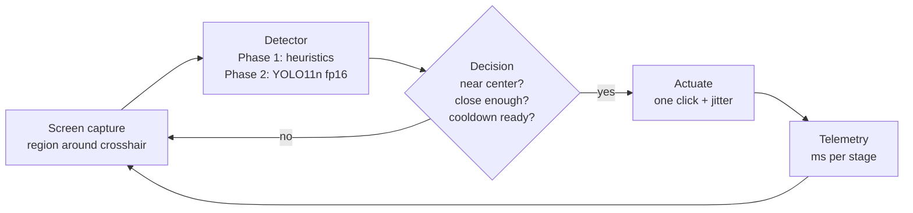

# BabyJev 🍼⚡

A mini **Jev-style reflex agent** for *singleplayer* Minecraft: watch the frame, decide in one pass, act. Named after [MCJev](https://haoailab.com/blogs/mcjev/), the 24 ms decision agent from UCSD's Hao AI Lab + NVIDIA.

**Status:** Phase 0 + Phase 1 scaffold. The decision loop runs end-to-end in self-test mode with zero game dependencies; the real detector is a swappable stub waiting for your experiment.

---

## The idea

Big reasoning models are too slow for a 60 fps world: 200 tokens of thinking at 200 tokens/s is a full second, and in that second you are dead. Jev's answer, scaled down to a laptop: skip the narration, look at the frame, check three conditions, fire. This repo is the smallest honest version of that loop, built to be taken apart.

## Architecture

## Latency budget (the whole point)

| Stage | Target | Notes |
|---|---|---|
| Capture | 10 ms | dxcam region capture, mss fallback |
| Detect | 15 ms | Phase 2: YOLO11n fp16 on a 4GB RTX 3050 |
| Decide | 1 ms | radius, proximity, cooldown checks |
| Act | 5 ms | one click via pynput |
| **Total** | **under 50 ms** | one Minecraft server tick |

Every stage is timed and written to telemetry, so you can see where the milliseconds actually go. (Spoiler: it is almost never the model.)

## Quickstart

    python -m pip install -r requirements.txt
    python capture_bench.py --seconds 10      # Phase 0: how fast can we see?
    python triggerbot.py --self-test         # full loop, no game needed
    python triggerbot.py --dry-run           # live capture, logged decisions, no clicks

Dry run is the default in config.json: it logs decisions to logs/telemetry.csv and does NOT click. Only flip dry_run to false in a world you own.

Hate the terminal? Double-click **build_exe.bat** once and you get **dist/BabyJev.exe**, no Python window needed ever again. Details in [docs/BUILD_EXE.md](docs/BUILD_EXE.md).

## Roadmap

See [ROADMAP.md](ROADMAP.md). Short version:

- **Phase 0** — capture benchmark (done, in this repo)
- **Phase 1** — heuristic detector: color/nametag logic in triggerbot.py
- **Phase 2** — YOLO11n: label a few hundred frames, swap the detector class
- **Phase 3** — polish: human-like jitter, CPS cap, attack cooldown tuning
- **Stretch** — publish your end-to-end latency next to Jev's 24 ms

## Rules of engagement

Singleplayer, LAN, or private worlds you own. Never point it at public servers, Realms, or anything with an account attached: the point of BabyJev is learning how fast decisions are made, not match outcomes. If it can play somewhere you don't own, it shouldn't.

## Credits and further reading

- [MCJev: Real-Time Decisions with Jev](https://haoailab.com/blogs/mcjev/) — the inspiration; 24 ms decisions, Minecraft PvP, 70% win rate vs humans
- [GameScaling](https://github.com/THUSI-Lab/GameScaling) — open-weights VLA game agents from the miHoYo Honkai AI team + universities
- [SIMA 2](https://deepmind.google/blog/sima-2-an-agent-that-plays-reasons-and-learns-with-you-in-virtual-3d-worlds/) — DeepMind's generalist agent for 3D worlds

## License

MIT. Have fun, break nothing, learn fast. 🚀
