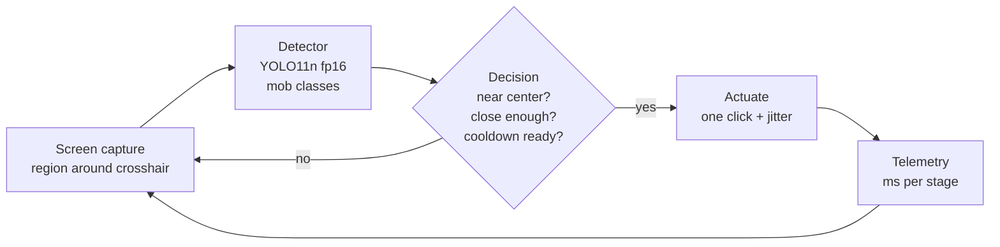

# BabyJev 🍼⚡

A mini **Jev-style reflex agent** for *singleplayer* Minecraft: watch the frame, decide in one pass, act. Named after [MCJev](https://haoailab.com/blogs/mcjev/), the 24 ms decision agent from UCSD's Hao AI Lab + NVIDIA.

**Status:** Phase 2. Decision loop proven at ~6 ms; YOLO eyes fine-tuned from an open Minecraft mob dataset ([Ivan711a/minecraft-mobs-yolo-dataset](https://huggingface.co/datasets/Ivan711a/minecraft-mobs-yolo-dataset), classes: creeper, skeleton, spider, zombie, enderman).

---

## The idea

Big reasoning models are too slow for a 60 fps world: 200 tokens of thinking at 200 tokens/s is a full second, and in that second you are dead. Jev's answer, scaled down to a laptop: skip the narration, look at the frame, check three conditions, fire. This repo is the smallest honest version of that loop, built to be taken apart.

## Architecture

## Latency budget (the whole point)

| Stage | Target | Measured on the dev machine (RTX 3050, mss capture) |
|---|---|---|
| Capture | 10 ms | ~13.5 ms (dxcam unavailable on Insider build) |
| Detect | 15 ms | YOLO11n @ 320 px input |
| Decide | 1 ms | ~0.5 ms |
| Act | 5 ms | ~4 ms (jitter included) |
| **Total** | **under 50 ms** | ~13.5 ms brain-only, + detection when eyes are on |

Every stage is timed and written to telemetry, so you can see where the milliseconds actually go.

## Quickstart

    python -m pip install -r requirements.txt
    python capture_bench.py --seconds 10      # Phase 0: your capture numbers
    python train.py                          # ONE TIME: downloads dataset, trains eyes (~20-40 min on GPU)
    python triggerbot.py --self-test         # loop sanity check, no game
    python triggerbot.py --dry-run            # real eyes on screen, logs decisions, never clicks
    python triggerbot.py                      # fighting mode: worlds you own ONLY

dry_run is the default in config.json. Only flip it to false in a world you own. Targets are set by target_classes in config.json (default: zombie, skeleton, spider, creeper; enderman left off because it is neutral until you look at it, and it does not appreciate reflex bots).

Hate the terminal? Double-click **build_exe.bat** once and you get **dist/BabyJev.exe**. Details in [docs/BUILD_EXE.md](docs/BUILD_EXE.md). (The exe covers capture/self-test modes; the YOLO-eye sessions are run via python.)

## Roadmap

See [ROADMAP.md](ROADMAP.md).

## Rules of engagement

Singleplayer, LAN, or private worlds you own. Never point it at public servers, Realms, or anything with an account attached: the point of BabyJev is learning how fast decisions are made, not match outcomes. If it can play somewhere you don't own, it shouldn't.

## Credits and further reading

- [MCJev: Real-Time Decisions with Jev](https://haoailab.com/blogs/mcjev/) — the inspiration; 24 ms decisions, Minecraft PvP, 70% win rate vs humans
- [GameScaling](https://github.com/THUSI-Lab/GameScaling) — open-weights VLA game agents from the miHoYo Honkai AI team + universities
- [SIMA 2](https://deepmind.google/blog/sima-2-an-agent-that-plays-reasons-and-learns-with-you-in-virtual-3d-worlds/) — DeepMind's generalist agent for 3D worlds
- [Minecraft mobs YOLO dataset](https://huggingface.co/datasets/Ivan711a/minecraft-mobs-yolo-dataset) — the eyes' training data

## License

MIT. Have fun, break nothing, learn fast. 🚀
